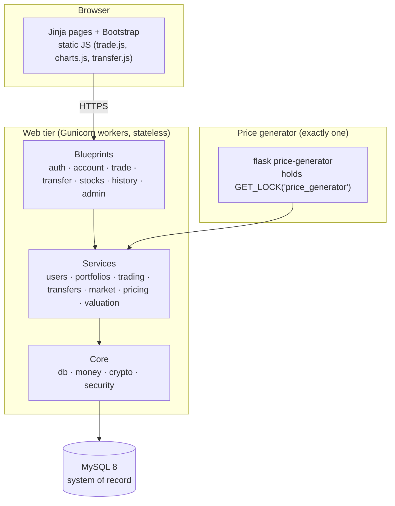

# Design Document

**Project:** Stock Trading System (Team 1 capstone)
**Implements:** `docs/requirements.md` (cited as R#, R#.#, N#, D#, A#, Q#)
**Reference diagrams:** `docs/reference/images/` (process maps `pm-*`, wireframes `wf-*`, `erd.png`, `network-topology.png`)

## Overview

The system is a server-rendered Flask application backed by MySQL. Every page is a Jinja template styled with Bootstrap; small plain-JavaScript files add interactivity (symbol lookup, charts, form behaviour). All business rules (market hours, funds and share checks, balance updates) live in a Python service layer and run inside MySQL transactions, so the database stays the single system of record.

A separate long-running worker process simulates the market: while the market is open it moves every stock's price at random intervals. Exactly one worker runs at a time, enforced by a MySQL lock.

### Design decisions

These are choices made in this document. Each can be revisited, but code should follow them until changed.

| ID | Decision | Rationale |
|---|---|---|
| DD1 | Raw parameterized SQL through **PyMySQL**, no ORM. | Matches the SAD's emphasis on SQL and parameterized queries (N2.1); the team works directly with the ERD; `SELECT … FOR UPDATE` and `ON DUPLICATE KEY UPDATE` are used directly. |
| DD2 | Schema managed by numbered `.sql` migration files applied by a Flask CLI command. | No ORM means no Alembic; plain SQL files are reviewable and match the DDL in this document. |
| DD3 | App structure: application factory + one **blueprint per page area** + a **service layer** for business logic. | Routes stay thin (parse form → call service → render); services are testable without HTTP. |
| DD4 | **Flask-Login** for sessions and Stay Signed In; **Flask-WTF** for forms and CSRF; **Flask-Limiter** for login rate limiting. | Standard, well-documented Flask extensions covering R1 and N2.3. |
| DD5 | Flask's default **signed-cookie sessions**. | Keeps the web tier stateless for the load balancer (N3.2) with no session store. Consequence: session contents are readable by the user, so nothing sensitive may be stored in the session or in flash messages (see Security). |
| DD6 | Price generator is a **separate worker process** (`flask price-generator`) holding a MySQL named lock. | Satisfies R16.6 on multiple web servers; approved by the team (D12). |
| DD7 | All timestamps stored in **UTC**; displayed and evaluated for market hours in **America/Phoenix** (D6). | UTC storage is unambiguous; Arizona has no DST, so conversion is a fixed −7h. |
| DD8 | Field encryption with **Fernet** (`cryptography`), key from an environment variable. | Covers N1.3 for SSNs and bank account numbers; `MultiFernet` allows key rotation. |
| DD9 | **Chart.js**, vendored into `static/vendor/` with Bootstrap. | Wireframes need line charts and sparklines; a chart library is not a frontend framework. Vendoring avoids CDN dependencies and keeps the Content Security Policy strict. |
| DD10 | Trades use a **two-step preview → confirm** flow. | Implements CR04/CR05 (R8.6, R9.5); see Trading. |
| DD11 | **Dark mode by default** with Bootstrap 5.3 colour modes (`data-bs-theme`), and a sun/moon toggle in `static/js/theme.js` that stores the choice in `localStorage`. | D13, R2.8–R2.9. Built into Bootstrap, so every component follows the theme with no extra CSS. |

---

## Architecture



### Request flow

1. A route parses and validates the form (Flask-WTF) and checks authorization (decorators).
2. The route calls one service function with plain values (IDs, `Decimal`s, strings).
3. The service opens a DB transaction, re-checks business rules against locked rows, writes, and commits, or raises a `DomainError` with a user-facing message.
4. The route renders the result, or re-renders the form with the error.

### Project layout

```
app/
  __init__.py            create_app(): config, extensions, blueprints, error handlers, CLI
  config.py              Config classes read from environment variables
  db.py                  connection per request (flask.g), transaction() context manager
  money.py               Decimal helpers: to_cents(), to_shares(), CENT, SHARE
  crypto.py              encrypt_field(), decrypt_field(), mask_last4()
  security.py            login_manager, @admin_required, security headers, limiter
  errors.py              DomainError and subclasses; 403/404/500 handlers
  clock.py               now_utc(), now_local(): single point to fake time in tests
  cli.py                 flask db-upgrade, create-admin, issue-temp-password, price-generator, seed
  services/              (signatures: see Service interfaces)
    types.py             frozen dataclasses passed between routes and services
    users.py             authenticate(), create_user(), deactivate_user(), list_users()
    portfolios.py        create_portfolio(), list_portfolios(), get_owned_portfolio()
    bank_accounts.py     add_bank_account(), list_bank_accounts()
    stocks.py            add_stock(), search_stocks(), get_stock()
    trading.py           quote(), preview_order(), execute_order()
    transfers.py         deposit(), withdraw()
    market.py            is_open(), market_status(), save_schedule()
    pricing.py           tick(), generate_history(), previous_close()
    valuation.py         account_summary(), positions(), top_gainers()
    history.py           search_history()
  auth/ account/ trade/ transfer/ stocks/ history/ admin/
                         each: __init__.py (blueprint), routes.py, forms.py
  templates/
    base.html            nav bar, profile dropdown, flash area, stale-price banner
    auth/ account/ trade/ transfer/ stocks/ history/ admin/ errors/
  static/
    css/app.css          includes @media print rules for History
    js/theme.js          dark/light toggle (loaded in <head> so the saved theme applies before the page draws)
    js/trade.js  js/transfer.js  js/charts.js
    vendor/              bootstrap, chart.js
migrations/
  001_initial_schema.sql
  002_…
tests/
  unit/  integration/  properties/  security/
.vscode/                 extensions.json, settings.json, launch.json (see VS Code)
.env.example             every variable from Configuration, no real values
requirements.txt         runtime dependencies, pinned
requirements-dev.txt     -r requirements.txt + test tools, pinned
pyproject.toml           pytest settings
scripts/
  setup_local_db.py      local .env, databases, and accounts (run by a developer with a MySQL admin account)
  check_task_graph.py    verifies the dependency graph in docs/tasks.md
```

`GET /health` returns `{"status": "ok"}` without logging in. It is used for smoke tests and uptime monitoring. Since task 6.2 it also checks the database: 200 `{"status": "ok", "database": "ok"}`, or 503 `{"status": "error", "database": "unavailable"}` with the MySQL error code in the log only (N3.4).

### Dependencies

| Package | Purpose |
|---|---|
| Flask, Jinja2 | web framework, templates (N5) |
| Flask-Login | sessions, Stay Signed In (R1) |
| Flask-WTF | forms, CSRF (N2.3) |
| Flask-Limiter | login rate limit (R1.9) |
| PyMySQL | MySQL driver (DD1) |
| cryptography | Fernet field encryption (DD8) |
| holidays | NYSE holiday calendar (D4) |
| tzdata | time-zone data for `zoneinfo`; **required on Windows** |
| gunicorn | production WSGI server (N3.1); Linux only, so local dev on Windows uses `flask run` |
| python-dotenv | load `.env` in local development |
| pytest, hypothesis | tests, property-based tests (`requirements-dev.txt` only) |

MySQL **8.0.19 or later** is required: the schema relies on enforced `CHECK` constraints (8.0.16+) and upserts use the `INSERT … AS new ON DUPLICATE KEY UPDATE` row alias (8.0.19+). Python **3.11 or later**.

**Version pinning:**

- `requirements.txt` (runtime) and `requirements-dev.txt` (`-r requirements.txt` plus test tools) pin exact versions with `==`, so every teammate and every server installs the same thing.
- Pins are set when the project is scaffolded: install the latest releases into `.venv`, run the test suite, and write the pins from `pip freeze`. They are not listed in this document, because they would go stale here.
- Upgrades are deliberate: one commit per upgrade, with the tests passing, never hand-edited to a guessed version.
- Gunicorn gets an environment marker so installs still work on Windows: `gunicorn==<version>; sys_platform != "win32"`.

---

## Data model

The ERD (`docs/reference/images/erd.png`) is the source of truth (D1). Table and column names are kept exactly as in the ERD, including camelCase IDs (`userID`) and PascalCase table names. `User`, `Transaction`, and the column `timestamp` are MySQL keywords, so **all SQL backtick-quotes table names and the `timestamp` column**.

### Deviations from the ERD

| ID | Change | Why |
|---|---|---|
| DV1 | `User.is_active` | Deactivate instead of delete (D7, R3.10). |
| DV2 | `User.failed_login_count`, `User.locked_until` | Temporary lockout that works across all web servers (A1, R1.8). |
| DV3 | New table `MarketSchedule` | AR04 needs somewhere to store admin-set hours; the ERD has none. |
| DV4 | New table `SystemState` | Generator heartbeat for the stale-price indicator (A17, R7.8). |
| DV5 | New table `PortfolioValueDaily` (migration 006) | Daily value snapshots for the charts and YTD (D23). |
| DV6 | Added `CHECK`, `UNIQUE`, and index constraints | Enforce invariants in the database (N2.4); no column changes. |
| DV9 | `Issuer.shares_available` required and never negative; new `Issuer.is_listed` (migration 003) | Limited share supply (D16) and delisting (D20). |
| DV10 | `MarketSchedule.start_date` and `end_date` removed (migration 004) | The Market Time form has no dates (D21). |
| DV12 | New `MarketSchedule.trading_days` (migration 008) and `market_override` (migration 009, replacing 008's `force_open`; exact-case in migration 010) | The Market Time form picks the trading days and can force the market open or closed (D29). |
| DV11 | New `BankAccount.is_active` (migration 007) | Remove a bank account without deleting it, so past transfers keep their bank account (D25, R10.7). |
| DV8 | Transfer type `Internal` and one History row per account for it (migration 005) | Transfers between a customer's own accounts (D15, R19). |
| DV7 | `User.must_change_password`, `User.temp_password_expires_at`, `User.session_version` (migration 002) | First-login password change and expiring temporary passwords (D10, R18); `session_version` ends a user's other logins when their password changes. |

### Schema (`migrations/001_initial_schema.sql`)

```sql
-- Connection setting used by the app and migrations: SET time_zone = '+00:00';
-- so CURRENT_TIMESTAMP(3) is UTC (DD7).

CREATE TABLE `User` (
  userID              INT AUTO_INCREMENT PRIMARY KEY,
  name                VARCHAR(255) NOT NULL,
  date_of_birth       DATE         NOT NULL,
  ssn                 VARCHAR(255) NOT NULL,              -- Fernet ciphertext (DD8)
  email               VARCHAR(320) NOT NULL UNIQUE,       -- stored lower-cased
  password_hash       VARCHAR(255) NOT NULL,
  signup              DATETIME(3)  NOT NULL DEFAULT CURRENT_TIMESTAMP(3),
  is_active           BOOLEAN      NOT NULL DEFAULT TRUE, -- DV1
  failed_login_count  INT          NOT NULL DEFAULT 0,    -- DV2
  locked_until        DATETIME(3)  NULL                   -- DV2
);

CREATE TABLE Admin (
  adminID       INT AUTO_INCREMENT PRIMARY KEY,
  userID        INT          NOT NULL UNIQUE,
  access_level  VARCHAR(20)  NOT NULL,
  department    VARCHAR(100) NULL,
  FOREIGN KEY (userID) REFERENCES `User`(userID)
);

CREATE TABLE BankAccount (
  bankAccountID   INT AUTO_INCREMENT PRIMARY KEY,
  userID          INT          NOT NULL,
  bank_name       VARCHAR(100) NOT NULL,
  nickname        VARCHAR(100) NOT NULL,
  account_number  VARCHAR(255) NOT NULL,                  -- Fernet ciphertext (DD8)
  routing_number  CHAR(9)      NOT NULL,
  created_at      DATETIME(3)  NOT NULL DEFAULT CURRENT_TIMESTAMP(3),
  FOREIGN KEY (userID) REFERENCES `User`(userID),
  CHECK (routing_number REGEXP '^[0-9]{9}$')
);

CREATE TABLE Portfolio (
  portfolioID     INT AUTO_INCREMENT PRIMARY KEY,
  userID          INT           NOT NULL,
  cash_balance    DECIMAL(10,2) NOT NULL DEFAULT 0.00,
  created_at      DATETIME(3)   NOT NULL DEFAULT CURRENT_TIMESTAMP(3),
  account_name    VARCHAR(100)  NOT NULL,
  account_type    VARCHAR(20)   NOT NULL,                 -- 'Brokerage' (D14)
  account_number  VARCHAR(20)   NOT NULL UNIQUE,
  FOREIGN KEY (userID) REFERENCES `User`(userID),
  CHECK (cash_balance >= 0)
);

CREATE TABLE Issuer (
  issuerID          INT AUTO_INCREMENT PRIMARY KEY,
  company_name      VARCHAR(255)  NOT NULL,
  ticker_symbol     VARCHAR(10)   NOT NULL UNIQUE,
  exchange          VARCHAR(10)   NULL,
  current_price     DECIMAL(10,2) NOT NULL,
  shares_available  DECIMAL(18,6) NULL,                   -- made NOT NULL, >= 0 in migration 003 (D16)
  description       VARCHAR(500)  NULL,
  CHECK (current_price >= 0.01),
  CHECK (REGEXP_LIKE(ticker_symbol, '^[A-Z0-9]{1,10}$', 'c'))
);

CREATE TABLE StockPrice (
  priceID      INT AUTO_INCREMENT PRIMARY KEY,
  issuerID     INT           NOT NULL,
  price_date   DATE          NOT NULL,                    -- Arizona trading date
  open_price   DECIMAL(10,2) NOT NULL,
  close_price  DECIMAL(10,2) NOT NULL,
  FOREIGN KEY (issuerID) REFERENCES Issuer(issuerID),
  UNIQUE KEY u_issuer_date (issuerID, price_date)         -- R16.7
);

CREATE TABLE Inventory (
  inventoryID   INT AUTO_INCREMENT PRIMARY KEY,
  portfolioID   INT           NOT NULL,
  issuerID      INT           NOT NULL,
  quantity      DECIMAL(18,6) NOT NULL,
  average_cost  DECIMAL(10,2) NOT NULL,
  reinvest      BOOLEAN       NOT NULL DEFAULT FALSE,     -- display-only toggle (D22)
  FOREIGN KEY (portfolioID) REFERENCES Portfolio(portfolioID),
  FOREIGN KEY (issuerID)    REFERENCES Issuer(issuerID),
  UNIQUE KEY u_portfolio_issuer (portfolioID, issuerID),
  CHECK (quantity > 0)                                    -- zero rows are deleted
);

CREATE TABLE `Transaction` (
  transactionID    INT AUTO_INCREMENT PRIMARY KEY,
  portfolioID      INT           NOT NULL,
  issuerID         INT           NOT NULL,
  type             VARCHAR(4)    NOT NULL,
  quantity         DECIMAL(18,6) NOT NULL,
  price_per_share  DECIMAL(10,2) NOT NULL,
  total_amount     DECIMAL(10,2) NOT NULL,
  status           VARCHAR(20)   NOT NULL,
  `timestamp`      DATETIME(3)   NOT NULL DEFAULT CURRENT_TIMESTAMP(3),
  order_type       VARCHAR(10)   NOT NULL,
  timing           VARCHAR(10)   NOT NULL,
  FOREIGN KEY (portfolioID) REFERENCES Portfolio(portfolioID),
  FOREIGN KEY (issuerID)    REFERENCES Issuer(issuerID),
  KEY k_portfolio_time (portfolioID, `timestamp`),
  CHECK (type IN ('Buy', 'Sell')),
  CHECK (status IN ('Filled')),
  CHECK (order_type IN ('Market')),                       -- A4
  CHECK (timing IN ('Day Only')),                         -- A4
  CHECK (quantity > 0 AND total_amount > 0)
);

CREATE TABLE Transfer (
  transferID        INT AUTO_INCREMENT PRIMARY KEY,
  from_portfolioID  INT           NULL,
  to_portfolioID    INT           NULL,
  bankAccountID     INT           NULL,
  amount            DECIMAL(10,2) NOT NULL,
  transfer_date     DATE          NOT NULL,
  status            VARCHAR(20)   NOT NULL,
  created_at        DATETIME(3)   NOT NULL DEFAULT CURRENT_TIMESTAMP(3),
  transfer_type     VARCHAR(10)   NOT NULL,
  FOREIGN KEY (from_portfolioID) REFERENCES Portfolio(portfolioID),
  FOREIGN KEY (to_portfolioID)   REFERENCES Portfolio(portfolioID),
  FOREIGN KEY (bankAccountID)    REFERENCES BankAccount(bankAccountID),
  CHECK (amount > 0),
  CHECK (status IN ('Pending', 'Completed')),
  CHECK (
    (transfer_type = 'Deposit'    AND bankAccountID IS NOT NULL AND to_portfolioID IS NOT NULL AND from_portfolioID IS NULL) OR
    (transfer_type = 'Withdrawal' AND bankAccountID IS NOT NULL AND from_portfolioID IS NOT NULL AND to_portfolioID IS NULL)
  )                                                       -- portfolio-to-portfolio: Q10
);

CREATE TABLE History (
  historyID      INT AUTO_INCREMENT PRIMARY KEY,
  portfolioID    INT          NOT NULL,
  transactionID  INT          NULL UNIQUE,
  transferID     INT          NULL UNIQUE,
  action         VARCHAR(50)  NOT NULL,
  `timestamp`    DATETIME(3)  NOT NULL DEFAULT CURRENT_TIMESTAMP(3),
  FOREIGN KEY (portfolioID)   REFERENCES Portfolio(portfolioID),
  FOREIGN KEY (transactionID) REFERENCES `Transaction`(transactionID),
  FOREIGN KEY (transferID)    REFERENCES Transfer(transferID),
  KEY k_portfolio_time (portfolioID, `timestamp`),
  CHECK ((transactionID IS NULL) <> (transferID IS NULL)) -- exactly one (R17.1)
);

-- DV3
CREATE TABLE MarketSchedule (
  scheduleID  INT AUTO_INCREMENT PRIMARY KEY,
  open_time   TIME        NOT NULL,                       -- Arizona local time
  close_time  TIME        NOT NULL,
  start_date  DATE        NULL,                           -- removed in migration 004 (D21)
  end_date    DATE        NULL,                           -- removed in migration 004 (D21)
  -- trading_days is added in migration 008 and market_override in migration 009 (D29)
  updated_by  INT         NOT NULL,
  updated_at  DATETIME(3) NOT NULL DEFAULT CURRENT_TIMESTAMP(3),
  FOREIGN KEY (updated_by) REFERENCES `User`(userID),
  CHECK (close_time > open_time)
);

-- DV4
CREATE TABLE SystemState (
  state_key    VARCHAR(50)  PRIMARY KEY,                  -- e.g. 'last_price_tick'
  state_value  VARCHAR(255) NOT NULL,
  updated_at   DATETIME(3)  NOT NULL DEFAULT CURRENT_TIMESTAMP(3)
);
```

`PortfolioValueDaily` (DV5) is specified under Valuation and added in migration 006 (D23).

### Migration `003_stock_supply_and_listing.sql` (DV9, task 2.3)

```sql
UPDATE Issuer SET shares_available = 0 WHERE shares_available IS NULL;
ALTER TABLE Issuer
  MODIFY shares_available DECIMAL(18,6) NOT NULL,
  ADD COLUMN is_listed BOOLEAN NOT NULL DEFAULT TRUE,
  ADD CONSTRAINT issuer_shares_not_negative CHECK (shares_available >= 0);
```

### Migration `004_schedule_without_dates.sql` (DV10, task 2.4)

```sql
ALTER TABLE MarketSchedule DROP COLUMN start_date, DROP COLUMN end_date;
```

### Migration `008_market_days_and_force_open.sql` (DV12, task 6.3)

```sql
ALTER TABLE MarketSchedule
  ADD COLUMN trading_days TINYINT UNSIGNED NOT NULL DEFAULT 31 AFTER close_time,  -- bit n = date.weekday() n (bit 0 = Monday); 31 = Mon-Fri
  ADD COLUMN force_open BOOLEAN NOT NULL DEFAULT FALSE AFTER trading_days,
  ADD CONSTRAINT market_schedule_days CHECK (trading_days BETWEEN 1 AND 127);
```

Existing rows get Monday to Friday and no override, so the market behaves exactly as before until an administrator saves new settings.

### Migration `009_market_override.sql` (DV12, task 6.3)

The one-way `force_open` switch became a three-way control (D29), so the flag becomes a value:

```sql
ALTER TABLE MarketSchedule
  ADD COLUMN market_override VARCHAR(10) NOT NULL DEFAULT 'Schedule' AFTER trading_days,
  ADD CONSTRAINT market_schedule_override CHECK (market_override IN ('Schedule', 'Open', 'Closed'));
UPDATE MarketSchedule SET market_override = 'Open' WHERE force_open;
ALTER TABLE MarketSchedule DROP COLUMN force_open;
```

### Migration `010_market_override_exact_case.sql` (DV12, task 6.3)

The database's default collation compares text without regard to case, so 009's `CHECK` accepted `'open'`, which the app can't read back. A binary collation makes the check exact:

```sql
ALTER TABLE MarketSchedule
  MODIFY market_override VARCHAR(10) CHARACTER SET utf8mb4 COLLATE utf8mb4_bin NOT NULL DEFAULT 'Schedule';
```

The older `CHECK (... IN (...))` columns (`Transaction.type`, `Transfer.status`, and so on) share the case-insensitive comparison; the app always writes them in the right case.

### Migration `007_bank_account_removal.sql` (DV11, task 3.1)

```sql
ALTER TABLE BankAccount ADD COLUMN is_active BOOLEAN NOT NULL DEFAULT TRUE;
```

Removed accounts are left out of `list_bank_accounts` and refused by deposits and withdrawals (`NotFound`, like an account that isn't the customer's). The app account still has no `DELETE` on `BankAccount`.

### Migration `006_portfolio_value_daily.sql` (DV5, task 3.3)

The `PortfolioValueDaily` table exactly as specified under Valuation, plus `SELECT, INSERT, UPDATE` for `trading_app` in `APP_PRIVILEGES`.

### Migration `005_internal_transfers.py` (DV8, task 3.1)

A Python migration (see Migrations below), because it must drop a `CHECK` constraint whose name MySQL generated: `transfer_chk_3` where table names are stored in lower case (Windows), `Transfer_chk_3` elsewhere. It finds the constraint by its clause instead of its name, then:

```sql
ALTER TABLE Transfer DROP CHECK <the generated name>;
ALTER TABLE Transfer ADD CONSTRAINT transfer_shape CHECK (
  (transfer_type = 'Deposit'    AND bankAccountID IS NOT NULL AND to_portfolioID IS NOT NULL AND from_portfolioID IS NULL) OR
  (transfer_type = 'Withdrawal' AND bankAccountID IS NOT NULL AND from_portfolioID IS NOT NULL AND to_portfolioID IS NULL) OR
  (transfer_type = 'Internal'   AND bankAccountID IS NULL AND from_portfolioID IS NOT NULL AND to_portfolioID IS NOT NULL
                                AND from_portfolioID <> to_portfolioID));
-- an Internal transfer has one History row per account: unique per (transfer, account) instead of per transfer
ALTER TABLE History ADD UNIQUE KEY u_history_transfer_portfolio (transferID, portfolioID);
ALTER TABLE History DROP INDEX transferID;   -- after the new index, which also serves the foreign key
```

**Migrations** are normally `.sql` files. A migration may be a `.py` file (same naming) defining `upgrade(cursor)` when plain SQL can't do the job, as here. `db-upgrade` runs both kinds in number order.

### Migration `002_password_change.sql` (DV7, task 3.5)

```sql
ALTER TABLE `User`
  ADD COLUMN must_change_password     BOOLEAN     NOT NULL DEFAULT FALSE,
  ADD COLUMN temp_password_expires_at DATETIME(3) NULL,
  ADD COLUMN session_version          INT         NOT NULL DEFAULT 0;

-- Existing customers (not administrators) were given temporary passwords, so they must change them (D10).
UPDATE `User` u LEFT JOIN Admin a ON a.userID = u.userID
   SET u.must_change_password = TRUE,
       u.temp_password_expires_at = UTC_TIMESTAMP(3) + INTERVAL 7 DAY
 WHERE a.adminID IS NULL;
```

### Reference values

| Column | Values |
|---|---|
| `Transaction.type` | `Buy`, `Sell` |
| `Transaction.status` | `Filled` |
| `Transaction.order_type` / `timing` | `Market` / `Day Only` (A4) |
| `Transfer.transfer_type` | `Deposit`, `Withdrawal`, `Internal` (D15) |
| `Transfer.status` | `Pending`, `Completed` |
| `History.action` | `Buy`, `Sell`, `Deposit`, `Withdrawal`, `Transfer out`, `Transfer in` |
| `Admin.access_level` | free text, 1–20 characters, entered when an administrator is created (D19) |

### Database accounts (N3.6)

| Account | Privileges | Used by |
|---|---|---|
| `trading_admin` (local development) | `CREATE`, `CREATE USER`, and `ALL ... WITH GRANT OPTION` on `trading_db` and `trading_test` | one-off setup run by a developer (`scripts/setup_local_db.py`); never used by the app |
| `trading_migrate` | `ALL PRIVILEGES ... WITH GRANT OPTION` on the two project databases only | `flask db-upgrade` and the test harness: runs migrations, then grants `trading_app` its table privileges |
| `trading_app` | `SELECT, INSERT, UPDATE` on all tables; `DELETE` **only** on `Inventory` | web app and price generator |

MySQL only allows table-level grants on tables that exist, so `trading_app`'s grants are applied after migrating: `flask db-upgrade` runs the migrations and then re-applies the per-table privileges in `APP_PRIVILEGES` (`app/migrate.py`). That is why `trading_migrate` has `GRANT OPTION` on the two project databases, and on nothing else. A migration that adds a table must also add it to `APP_PRIVILEGES`; a test fails if they disagree.

`trading_app` has no `DELETE` on `Transaction`, `Transfer`, or `History`, and no `UPDATE` on `Transaction` or `History`, so the audit trail cannot be altered through the app even by a bug (R17.2). (`Transfer` needs `UPDATE` for Pending → Completed.)

---

## Components

### Core modules

**`db.py`**: one PyMySQL connection per request, stored on `flask.g` and closed at teardown; `DictCursor`; `autocommit=False`; every connection runs `SET time_zone = '+00:00'`.

```python
with db.transaction() as cur:      # BEGIN … COMMIT, ROLLBACK on any exception
    cur.execute("SELECT cash_balance FROM Portfolio WHERE portfolioID = %s FOR UPDATE", (pid,))
```

Only `%s` placeholders are allowed; SQL strings never contain user values (N2.1).

**`money.py`**: all money is `decimal.Decimal` (PyMySQL returns `DECIMAL` columns as `Decimal`).

| Helper | Rule |
|---|---|
| `to_cents(x)` | `x.quantize(Decimal("0.01"), ROUND_HALF_UP)` |
| `to_shares_floor(x)` | `x.quantize(Decimal("0.000001"), ROUND_DOWN)`: quantities derived from dollars |
| `parse_money(str)` | rejects anything that is not a positive amount with at most 2 decimals |

**`crypto.py`**: `encrypt_field()` / `decrypt_field()` with `MultiFernet` over keys from `FIELD_ENCRYPTION_KEYS` (comma-separated, newest first). `mask_last4("123456789") → "•••• 6789"`. Decrypted values are never logged.

**`clock.py`**: `now_utc()` and `now_local()` (America/Phoenix). All code reads time through these so tests can fix the clock.

**`errors.py`**: `DomainError(message)` carries the exact user-facing text from Error handling. Subclasses: `InvalidCredentials`, `AccountLocked`, `TemporaryPasswordExpired`, `Forbidden` (rendered as the 403 page), `MarketClosed`, `InsufficientFunds`, `InsufficientShares`, `SymbolNotFound`, `DuplicateSymbol`, `NoBankAccount`, `OrderExpired`, `ValidationFailed` (field name + message), and `NotFound` (rendered as the 404 page).

### Service interfaces

Conventions for every service function:

- **Errors are exceptions, not return flags.** Success returns a value; any rule violation raises a `DomainError` subclass. Routes catch `DomainError` and show its message.
- **Customer data is scoped by the first argument.** Functions that touch a customer's records take `user_id` first and only ever see that user's rows.
- **Services own their DB transaction.** Callers never commit or roll back.
- **Money and quantities are `Decimal`**, never `float`, in every argument and return value.
- **Time and randomness are injectable** (`at_utc`, `rng`), defaulting to `clock.now_utc()` and a module-level `random.Random()`, so tests are deterministic.

**Value types** (`services/types.py`, all `@dataclass(frozen=True)`):

```python
class OrderRequest:
    portfolio_id: int
    symbol: str
    action: Literal["Buy", "Sell"]
    unit: Literal["Dollars", "Shares"]           # A3
    amount: Decimal                              # dollars or shares, per unit
    order_type: Literal["Market"] = "Market"     # A4
    timing: Literal["Day Only"] = "Day Only"     # A4

class Quote:
    symbol: str
    company_name: str
    price: Decimal
    previous_close: Decimal
    change: Decimal
    change_pct: Decimal
    market: "MarketStatus"
    shares_owned: Decimal | None                 # set when a portfolio is given

class OrderPreview:
    request: OrderRequest
    quote: Quote
    quantity: Decimal
    total: Decimal                               # estimate: executes at confirm-time price (D11)

class OrderResult:
    transaction_id: int
    symbol: str
    action: Literal["Buy", "Sell"]
    quantity: Decimal
    price: Decimal
    total: Decimal
    cash_balance: Decimal                        # after the trade

class TransferResult:
    transfer_id: int
    transfer_type: Literal["Deposit", "Withdrawal", "Internal"]
    amount: Decimal
    cash_balance: Decimal                        # after the transfer (the From account for Internal)
    portfolio_name: str
    to_cash_balance: Decimal | None = None       # Internal only (R19.5)
    to_portfolio_name: str | None = None

class MarketStatus:
    is_open: bool
    closes_at: datetime | None                   # Arizona local; None while closed
    next_open: datetime | None                   # Arizona local; None while open
```

Read-model types (`UserRow`, `PortfolioRow`, `BankAccountRow`, `StockRow`, `PositionRow`, `AccountSummary`, `PositionsView`, `StockMover`, `HistoryRow`) are plain dataclasses shaped like the page tables they feed. Account numbers in them are already masked, and no read model carries an SSN at all (D8).

**Functions** (`→` return value; `!` exceptions beyond `ValidationFailed` and `NotFound`):

| Module | Signature | Notes |
|---|---|---|
| users | `authenticate(email: str, password: str, at_utc=None) → UserRow` | ! `InvalidCredentials`, `AccountLocked` |
| users | `create_user(admin_id: int, name: str, ssn: str, email: str, dob: date, role: str = "Customer", access_level: str \| None = None, department: str \| None = None) → tuple[int, str]` | returns `(user_id, temp_password)`; role Administrator needs an access level (D19) |
| users | `update_user(admin_id: int, user_id: int, name: str, email: str, dob: date) → UserRow` | not SSN or role (D20) |
| users | `deactivate_user(admin_id: int, user_id: int) → None` | refuses self-deactivation |
| users | `list_users() → list[UserRow]` | no SSN field (D8) |
| users | `change_password(user_id: int, new_password: str, confirm: str) → UserRow` | first-login change (R18.5–R18.7); bumps `session_version` |
| users | `issue_temporary_password(admin_user_id: int, user_id: int) → str` | returns the new temporary password (R18.9); not for oneself |
| portfolios | `create_portfolio(user_id: int, account_name: str, account_type: str) → PortfolioRow` | type must be in `ACCOUNT_TYPES` (Brokerage, D14) |
| portfolios | `list_portfolios(user_id: int) → list[PortfolioRow]` | |
| portfolios | `get_owned_portfolio(user_id: int, portfolio_id: int) → PortfolioRow` | `NotFound` if not the user's |
| bank_accounts | `add_bank_account(user_id: int, bank_name: str, account_number: str, routing_number: str, nickname: str) → BankAccountRow` | |
| bank_accounts | `list_bank_accounts(user_id: int) → list[BankAccountRow]` | account numbers masked |
| bank_accounts | `remove_bank_account(user_id: int, bank_account_id: int) → BankAccountRow` | hides it (D25); ! `NotFound` |
| stocks | `add_stock(admin_id: int, company_name: str, symbol: str, price: Decimal, description: str \| None, exchange: str \| None, randomize_history: bool, shares: Decimal, rng=None) → int` | ! `DuplicateSymbol`; shares > 0 (D16) |
| stocks | `update_stock(admin_id: int, issuer_id: int, company_name: str, description: str \| None, exchange: str \| None) → StockRow` | not symbol or price (D20) |
| stocks | `delist_stock(admin_id: int, issuer_id: int) → None` | hidden from search and buying; holders can still sell (D20) |
| stocks | `search_stocks(query: str) → list[StockRow]` | |
| stocks | `get_stock(symbol: str) → StockRow` | ! `SymbolNotFound` |
| trading | `quote(user_id: int, symbol: str, portfolio_id: int \| None = None, at_utc=None) → Quote` | ! `SymbolNotFound` |
| trading | `preview_order(user_id: int, req: OrderRequest, at_utc=None) → OrderPreview` | ! `MarketClosed`, `InsufficientFunds`, `InsufficientShares`, `SymbolNotFound` |
| trading | `execute_order(user_id: int, req: OrderRequest, at_utc=None) → OrderResult` | same, re-checked under row locks |
| transfers | `deposit(user_id: int, bank_account_id: int, portfolio_id: int, amount: Decimal, transfer_date: date, at_utc=None) → TransferResult` | |
| transfers | `withdraw(user_id: int, portfolio_id: int, bank_account_id: int, amount: Decimal, transfer_date: date, at_utc=None) → TransferResult` | ! `InsufficientFunds` |
| transfers | `move_between(user_id: int, from_portfolio_id: int, to_portfolio_id: int, amount: Decimal, transfer_date: date, at_utc=None) → TransferResult` | own accounts only (D15, R19); ! `InsufficientFunds` |
| market | `is_open(at_utc: datetime) → bool` | |
| market | `market_status(at_utc: datetime) → MarketStatus` | |
| market | `save_schedule(admin_id: int, open_time: time, close_time: time) → None` | no dates (D21) |
| pricing | `tick(at_utc: datetime, rng: random.Random) → int` | returns stocks updated; no-op if closed |
| pricing | `generate_history(cur, issuer_id: int, price: Decimal, today: date, rng: random.Random) → None` | runs inside the caller's transaction |
| pricing | `previous_close(issuer_id: int, today: date) → Decimal` | |
| valuation | `account_summary(user_id: int) → AccountSummary` | |
| valuation | `positions(user_id: int, portfolio_id: int) → PositionsView` | |
| valuation | `top_gainers(limit: int = 5) → list[StockMover]` | listed stocks only |
| valuation | `trending(limit: int = 5, at_utc=None) → list[StockMover]` | most filled trades today, Arizona time (D18, A19) |
| history | `search_history(viewer_id: int, portfolio_id: int \| None, start: date, end: date, symbol: str \| None) → list[HistoryRow]` | admins (looked up) may pass any portfolio, or `ALL` (None) for everyone's; ! `NotFound` |

### Authentication and sessions (R1, R2, R3.10–3.11)

- **Login** (`POST /signin`): normalize the email to lower case → load the user → if `locked_until > now`, reject with the lockout message → verify with `werkzeug.security.check_password_hash` → on success reset `failed_login_count`, `login_user(user, remember=stay_signed_in)`, redirect by role. On failure, increment `failed_login_count`; at 5, set `locked_until = now + 15 min` and reset the count (A1). Unknown emails and wrong passwords get the same message and a dummy hash check, so response time does not reveal which one it was.
- **Stay Signed In** (R1.5): the Flask session cookie is non-permanent (ends with the browser); with the box checked, Flask-Login also sets a remember cookie for 30 days (A2).
- **User loading**: `user_loader` returns `None` for users with `is_active = FALSE`, so a deactivated user is signed out on their next request, remember cookie included (R3.10).
- **Role**: a user is an administrator if and only if an `Admin` row references them. `current_user.is_admin` is loaded with the user.
- **Decorators**: `@login_required` on every route except `/signin`; `@admin_required` returns 403 for non-admins (R2.4).
- **Ownership**: services take `user_id` and scope every query by it, e.g. `get_owned_portfolio(user_id, portfolio_id)` raises `NotFound` (404) for someone else's portfolio. Returning 404 instead of 403 avoids confirming that the ID exists (R2.5). Admins bypass ownership only on History (R13.6).
- **Rate limit** (R1.9): Flask-Limiter, `10/minute` per IP on `POST /signin`. In-memory storage is per server, so the effective limit scales with server count; the DB lockout is the cross-server control.
- **Logout** (R1.10): `POST /logout` with a CSRF token (a nav-bar form, not a link), calling `logout_user()`, which clears both cookies.
- **First-login password change** (R18, D10; task 3.5):
  - `create_user` and `issue_temporary_password` set `must_change_password = TRUE` and `temp_password_expires_at = now + TEMP_PASSWORD_DAYS` (A18).
  - `authenticate`: a correct password with `must_change_password` set and an expiry in the past raises `TemporaryPasswordExpired` (R18.8). Only a *correct* password reveals this; wrong passwords still get the generic message. The lockout rules apply as usual (R18.11).
  - At login, `remember` is forced off while a change is required (R18.4).
  - A `before_app_request` guard, registered after the login guard, redirects every endpoint except `auth.change_password`, `auth.logout`, and public views to `/change-password` while `current_user.must_change_password` is set (R18.3).
  - `change_password` validates with `validation.password()` (N1.6), refuses the current temporary password, stores the new hash, clears the flag and expiry, and increments `session_version` (R18.6, R18.7).
- **Ending other logins** (`session_version`): Flask-Login's user ID is stored as `"<userID>:<session_version>"` (`get_id()`), in the session and in the remember cookie. The user loader returns `None` when the version no longer matches, so bumping `session_version` (password change, new temporary password) signs out every other browser, remember cookies included. The browser that changed the password is logged in again with the new ID.

### User administration (R3)

- `create_user(name, ssn, email, dob)`: validate → `temp = secrets.token_urlsafe(12)` → insert with `password_hash = generate_password_hash(temp)` and `ssn = encrypt_field(ssn)` → return `temp`.
- **The temporary password is shown in the response to the POST itself**, with `Cache-Control: no-store`, and not via redirect + flash. Flash messages live in the signed but unencrypted session cookie (DD5), so the password must never pass through it (R3.4–3.5).
- `deactivate_user(user_id)`: sets `is_active = FALSE`. An admin cannot deactivate themselves.
- **Bootstrapping the first admin**: `flask create-admin` (CLI) prompts for name, email, and password and creates the `User` and `Admin` rows. Later administrators are created from Add User by choosing Administrator (D19).
- **New temporary passwords** (R18.9, R18.10): `issue_temporary_password` is admin-only, refuses the caller's own account, generates a new temporary password, replaces the hash, sets the change flag and a new expiry, clears any lockout, and bumps `session_version`. The Users list (task 4.5) shows the result once, like R3.4. `flask issue-temp-password` does the same from the server for any account, for when the only administrator is locked out.
- **Roles (D19):** administrators hold no portfolios and do not trade. The navigation shows them Stocks, Administration, and History; a `@customer_required` decorator returns 403 to administrators on Account, Positions, Trade, and Transfer Funds, and the portfolio, bank-account, transfer, and trading services refuse administrators too (defence in depth).
- **Editing (D20):** `update_user` changes name, email, and date of birth with the same validation as creation; SSN and role are fixed.

### Portfolios (R4)

- `create_portfolio(user_id, name, type)`: `account_number` is a random 10-digit string from `secrets.randbelow` (A10); on a `UNIQUE` collision, retry up to 5 times.
- Account types come from `ACCOUNT_TYPES` in `config.py`: just `Brokerage` (D14). With one type, the Create Portfolio form (task 4.2) shows it as fixed text instead of a choice; a `<select>` appears automatically if more types are ever added.

### Bank accounts (R10)

- `add_bank_account(user_id, bank_name, account_number, routing_number, nickname)`: routing number must match `^\d{9}$`; account number must be digits only (4–17, the US range); stored encrypted.
- Dropdowns show `"{nickname} •••• {last4}"`.

### Market clock (R15, R8.4, R9.3, R16)

```python
def is_open(at_utc, schedule) -> bool:
    if schedule.override == "Open":                             # D29: beats hours, days, and holidays
        return True
    if schedule.override == "Closed":                           # D29: beats the hours
        return False
    local = at_utc.astimezone(ZoneInfo("America/Phoenix"))      # D6
    if not is_trading_day(local.date(), schedule):              # a chosen day (Mon–Fri by default, AR05), not a holiday
        return False
    return schedule.open_time <= local.time() < schedule.close_time
```

- `Schedule(open_time, close_time, trading_days, override)`: `override` is `"Schedule"` (the default), `"Open"`, or `"Closed"`, stored in `MarketSchedule.market_override`; `trading_days` is a set of `date.weekday()` numbers (0 = Monday), stored as a bit mask in `MarketSchedule.trading_days` (DV12); at least one day is required.
- `is_holiday(d)` uses `holidays.NYSE(years=d.year)`, cached per year (D4, A16). `is_trading_day(d, schedule)` is a chosen weekday that is not a holiday; with the default schedule it is Monday to Friday, which Randomize History keeps using (A9).
- `current_schedule()` returns the most recently saved `MarketSchedule` row, or the default (09:00–17:00, Monday to Friday, not forced) if none exists. The settings apply until changed; there are no dates (D21, D29).
- `save_schedule(admin, open_time, close_time, trading_days, override)` inserts one row with all four, so a save is all or nothing and every row records who changed it (R15.8, R17).
- `market_status()` returns `open`/`closed` plus when it closes (if open) or next opens (if closed), for the Trade page badge (R15.6) and the Market Time card (R15.9). While forced open it returns `is_open=True, forced_open=True` with no close time; while forced closed, `is_open=False, forced_closed=True` with no next open time (nobody knows when an administrator will choose Schedule again).
- While forced closed the generator moves no prices (R16.5) and the stale-price banner stays off, as on any closed day; the day's value snapshot is still saved after the scheduled close.
- Trading services call `is_open()` twice: once at preview and once inside the execute transaction (R8.7).

### Trading (R8, R9)

The Trade page is a two-step flow (DD10), so the confirmation required by CR04 is a real screen, and a confirmed order cannot be cancelled (CR05).

```mermaid
sequenceDiagram
    actor C as Customer
    participant R as trade routes
    participant T as trading service
    participant DB as MySQL

    C->>R: GET /api/quote/AAPL?portfolio=12
    R-->>C: name, price, change, market status, shares owned
    C->>R: POST /trade/preview (action, unit, amount, …)
    R->>T: preview_order()
    T->>DB: read price, cash / shares (no locks)
    T-->>R: OrderPreview or DomainError
    R-->>C: confirmation screen (order stored in session with nonce, 2-min expiry)
    C->>R: POST /trade/confirm (nonce)
    R->>T: execute_order()
    T->>DB: BEGIN; lock Portfolio, Inventory rows (FOR UPDATE)
    T->>T: re-check market open, funds / shares at current price
    T->>DB: UPDATE cash, upsert/delete Inventory, INSERT Transaction, INSERT History
    T->>DB: COMMIT
    R-->>C: order confirmation (nonce removed from session)
```

**Quantity and total** (A3):

| Unit | Quantity | Total |
|---|---|---|
| Dollars | `to_shares_floor(amount / price)` | `to_cents(quantity × price)` (never more than `amount`) |
| Shares | as entered (up to 6 decimals, > 0) | `to_cents(quantity × price)` |

A computed quantity of 0 (dollar amount smaller than 0.000001 shares) is rejected as a validation error, and so is a total under $0.01 (for example 0.000001 shares of a $30 stock; `Transaction.total_amount` must be positive) or over $99,999,999.99.

**`execute_order` transaction** (row locks are always taken Portfolio → Inventory → Issuer to avoid deadlocks, D16). The transaction runs at READ COMMITTED: at MySQL's default REPEATABLE READ, locking an Inventory row that doesn't exist yet takes a gap lock, and two customers opening new positions at once deadlock (error 1213; a test reproduces it). Every change to a portfolio's positions happens under its Portfolio row lock, so nothing relies on gap locks.

1. `SELECT cash_balance FROM Portfolio WHERE portfolioID=%s AND userID=%s FOR UPDATE`
2. `SELECT quantity, average_cost FROM Inventory WHERE portfolioID=%s AND issuerID=%s FOR UPDATE`
3. `SELECT current_price, shares_available, is_listed FROM Issuer WHERE issuerID=%s FOR UPDATE` (the price generator waits for the trade to finish)
4. `market.is_open(now)` → `MarketClosed`
5. Recalculate quantity/total at the current price; funds or shares check → `InsufficientFunds` / `InsufficientShares`
6. Buy: `cash -= total`; upsert Inventory with `new_avg = to_cents((q×avg + bq×price) / (q+bq))`.
   Sell: `cash += total`; `quantity -= sq`; `DELETE` the row if it reaches 0; `average_cost` unchanged (R9.6).
7. `INSERT` Transaction (`Filled`, `Market`, `Day Only`) and History (`action = type`).

**Execution price (D11, approved):** execute at the **current price at the moment of confirming**. The confirmation screen labels the price and total as estimates. For a Dollars order the quantity is recalculated so the total never exceeds the amount; for a Shares order the total may differ slightly, and the funds check runs again.

**Double submission:** the confirm button is disabled by JavaScript on submit, and the session nonce is consumed on first use. (Replaying an old session cookie could re-present a nonce; the second order would still pass every check against current balances, so there is no integrity risk.)

**Search History** (A13): the last 5 symbols entered, kept in the session.

**Shares available** (D16): step 3 locks the Issuer row `FOR UPDATE` too (lock order Portfolio → Inventory → Issuer), a buy is refused with "Not enough shares available" if the quantity exceeds `shares_available` and otherwise reduces it, and a sell adds the quantity back (CR08).

**Delisted stocks** (D20): a delisted stock can't be bought (`SymbolNotFound`), but a customer holding it can still get a quote and sell.

### Transfers (R10–R12)

- The From and To dropdowns both list the customer's bank accounts and portfolios. The server derives the type: bank → portfolio = `Deposit`; portfolio → bank = `Withdrawal`; portfolio → a different portfolio of the same customer = `Internal` (D15); bank → bank or a portfolio to itself is a validation error. `transfer.js` narrows the To list after a From choice as a convenience only.
- **Deposit transaction:** lock Portfolio `FOR UPDATE` → `INSERT` Transfer (`Pending`) → `cash += amount` → `UPDATE` Transfer to `Completed` → `INSERT` History → `COMMIT`. The Pending state mirrors the process map and exists only inside the DB transaction.
- **Withdrawal transaction:** the same, plus a check that `amount <= cash_balance` under the lock → `InsufficientFunds`. "Send funds to the bank" is recorded, not performed.
- Transfer Date must equal today's Arizona date (A5).
- **Between own accounts** (`move_between`, D15, R19): locks both portfolios `FOR UPDATE` in `portfolioID` order (so two opposite moves can't deadlock), checks the From account's cash, creates an `Internal` Transfer naming both, moves the cash, and writes a `Transfer out` History row on the From account and a `Transfer in` row on the To account. The page allows portfolio → portfolio (different accounts) and still refuses bank → bank.
- **From/To menus:** each account shows its name on the left and its cash balance on the right (bank accounts: nickname on the left, bank name on the right). The last 4 digits are added only when two of the customer's accounts share a name, since that's the only way to tell them apart. `transfer.js` draws the menus as a Bootstrap dropdown over the native `<select>`, which stays in the form (and is what submits), so the page still works without JavaScript.
- **Removing a bank account** (D25, R10.6–R10.8): the Add Bank Account panel lists the customer's bank accounts with a Remove button (`POST /transfer/bank-accounts/<id>/remove`), which asks for confirmation in JavaScript. `bank_accounts.remove_bank_account(user_id, id)` sets `is_active = FALSE`; another customer's account is `NotFound`.
- With no bank accounts, the page shows the R11.6 message. The form stays usable only if the customer has two or more portfolios to move cash between (R19); otherwise it is disabled.

### Price generator (R16, R14.6)

Runs as `flask price-generator` (DD6); the code is in `services/price_generator.py` (`tick`, `snapshot_values`, `prices_stale`, `run`), with the pure price math in `services/pricing.py`.

```python
def run():
    lock_conn = db.new_connection()
    if not acquire_named_lock(lock_conn, "price_generator:" + DB_NAME):   # SELECT GET_LOCK(…, 0)
        log.info("another generator holds the lock; exiting")
        return
    while True:
        sleep(random.uniform(TICK_MIN, TICK_MAX))                # A7: 30–120 s
        if market.is_open(clock.now_utc()):
            tick()
```

- The named lock is held by `lock_conn` for the life of the process and released automatically if the process dies, so a standby instance can take over. `GET_LOCK` names are server-wide, so the name includes the database: a generator for `trading_db` doesn't block the tests' generator on `trading_test`.
- A pass that fails (for example, a lost database connection) is logged and the loop carries on with the next pass.
- **Delisted stocks are not moved** (D20): their price stays where it was when delisted, so holders see a fixed value.

**Price model (A7).** Prices follow a random walk (geometric Brownian motion) sized so a typical stock moves **about 1.5% per trading day** (one standard deviation), roughly 24% a year, like an individual large US stock. The move on each tick is scaled by how much time has passed, so daily volatility is the same whether ticks are 30 or 120 seconds apart:

```python
dt       = min(seconds_since_last_tick, TICK_MAX) / trading_day_seconds   # 28,800 s for 9–5
sigma    = DAILY_VOLATILITY * sqrt(dt)                                     # ≈ 0.077% for a 75 s tick
r        = clamp(rng.gauss(0, sigma), -MAX_TICK_CHANGE, +MAX_TICK_CHANGE)  # cap: 1%, a safety net
exact    = max(Decimal("0.01"), exact * Decimal(r).exp())
stored   = to_cents(exact)
```

- `min(…, TICK_MAX)` stops the overnight gap from counting as elapsed trading time, so the first tick of the day is an ordinary-sized move (SR03).
- **Full precision is kept in memory.** The generator holds each stock's unrounded `exact` price as a `Decimal` and writes only the rounded value. Rounding the stored price each tick would freeze cheap stocks: a $1 stock's typical tick is under a tenth of a cent, which would always round away. On startup, or whenever the stored price no longer equals `to_cents(exact)` (a new stock, or a price changed some other way), `exact` is reset from the database.
- No drift: prices are equally likely to rise or fall.
- The 1% cap never binds in normal operation (a 1% tick is about 13 standard deviations); it only guards against misconfiguration.

Simulated over 250 trading days × 200 runs with 30–120 s ticks, this model gives a daily move of 1.50% at $150, $5, and $1 starting prices, and a one-year change between −34% and +49% for the middle 90% of runs. The previous uniform ±1%-per-tick model gave 11% daily moves (−99% to +103% in a year) and froze a $1 stock on 78% of days.

- **`tick()`**, in one DB transaction:
  1. For every Issuer, compute the new price with the model above.
  2. `UPDATE Issuer SET current_price = new`.
  3. `INSERT INTO StockPrice (issuerID, price_date, open_price, close_price) VALUES (%s, %s, %s, %s) AS new ON DUPLICATE KEY UPDATE close_price = new.close_price`, with `open_price` = the price before this tick (unchanged since the previous close, because nothing moves while the market is closed). The first tick of the day creates the row with `open = previous close` (A8); later ticks only move `close_price` (R16.2, R16.4, R16.7).
  4. `UPSERT SystemState ('last_price_tick', now)` for the stale-price indicator.
- Because `tick()` only runs while the market is open, prices stay unchanged while it is closed (R16.5).
- **Daily value snapshot (D23):** on the first loop pass after the close of a trading day (a chosen day under the current schedule; never while the market is forced open, D29), if that day has no snapshot yet, the generator writes one `PortfolioValueDaily` row per portfolio (cash + Σ quantity × close price) in one transaction. `INSERT … ON DUPLICATE KEY UPDATE` makes a rerun harmless, and a generator that was down catches up on its next pass the same day.
- **Randomize History** (`generate_history(issuer_id, price)`, R14.6, A9): walk backwards over the past year's trading days (weekdays, excluding NYSE holidays) from the entered price, `close[d-1] = close[d] / exp(gauss(0, DAILY_VOLATILITY))` (the same 1.5% daily volatility as live ticks, so history and live prices look alike), `open[d] = close[d-1]`, kept at full precision during the walk and rounded to cents when stored, floored at 0.01. Today's row has `open = close = price`. Inserted in one batch in the same transaction as the Issuer row. With the toggle off, only today's row is created.
- **Stale indicator** (R7.8, A17): a context processor sets `prices_stale = market open AND now − last_price_tick > 300 s`; `base.html` shows a "Prices may be delayed" banner.

### Valuation and market data (R5, R6, R7)

Implements the Calculations table in the requirements.

- **Previous close** for a stock: `close_price` of the latest `StockPrice` row with `price_date < today`; if none exists, the current price (change = 0).
- **Per-position values** come from one query per portfolio joining `Inventory`, `Issuer`, and the previous-close subquery; all arithmetic in `Decimal` in Python.
- **Top Gainers** (A14): the top 5 Issuers by `(current_price − previous_close) / previous_close`.
- **Stock chart / sparklines**: `close_price` series from `StockPrice` (last 365 days for detail, last 30 for sparklines), passed to Chart.js as a JSON `<script type="application/json">` block (CSP-safe).
- **Search** (R7.1–7.2): `WHERE ticker_symbol LIKE %s OR company_name LIKE %s` with `%query%` bound as a parameter (LIKE wildcards `%` and `_` in user input are escaped). Case-insensitive through MySQL's default `utf8mb4_0900_ai_ci` collation.

**Value charts and YTD (D23):** `PortfolioValueDaily` (DV5), written once per trading day by the price generator after the market closes:

```sql
CREATE TABLE PortfolioValueDaily (
  portfolioID  INT           NOT NULL,
  value_date   DATE          NOT NULL,
  cash         DECIMAL(10,2) NOT NULL,
  total_value  DECIMAL(12,2) NOT NULL,
  PRIMARY KEY (portfolioID, value_date),
  FOREIGN KEY (portfolioID) REFERENCES Portfolio(portfolioID)
);
```

- Charts plot `total_value` over time, with today's live value as the last point.
- **YTD change** = current value − value at the last snapshot of the previous year (0 for portfolios opened this year) − net deposits this year, so deposits are not counted as gains.
  - "This year" is the Arizona calendar year of `Transfer.transfer_date`. Net money put in = completed deposits and moves in (R19) − withdrawals and moves out. Moves between a customer's own portfolios cancel out in the Summary totals.
  - A portfolio with no snapshot before 1 January counts a start-of-year value of $0.00.
- **Percentages (D26):** Day change % = day change ÷ (value − day change); YTD % = YTD change ÷ (start-of-year value + net money put in); Gain/loss % = gain/loss ÷ cost basis; 0.00% when the base is $0.00. Money values are rounded to the cent per position, then summed, the same way as the snapshots.
- **Chart points:** one per snapshot over the last 365 days, and today's live value as the last point (it replaces today's snapshot if there is one). The Summary chart adds the portfolios' values per day.
- **Types:** `PositionRow` (one equity row), `ValueTotals` (cash, positions value, total value, day change, YTD change, cost basis, gain/loss, and their percentages), `PortfolioSummaryRow`, `AccountSummary` (rows, totals, chart points), and `PositionsView` (portfolio, positions, equity totals, portfolio totals, chart points).
- **Reinvest? (D22):** `portfolios.set_reinvest(user_id, portfolio_id, issuer_id, on)` updates only `Inventory.reinvest`; someone else's portfolio or a position that doesn't exist is `NotFound`.
- **Create Portfolio (A11, R4.4):** the confirmation shows the new account number masked to the last 4 digits ("•••• 1234"), like every other place a portfolio number appears (R5.3).
- Reconstructing history from past trades and prices was considered and rejected: it requires replaying every trade for every chart load.

### History (R13, R17)

- Query `History` joined to `Transaction`/`Issuer` or `Transfer`/`BankAccount`, filtered by `portfolioID`, a UTC range converted from the Arizona date range, and an optional symbol; newest first.
- **Description column**: trades show `"Bought 1.5 AAPL @ $336.79"` / `"Sold …"`; transfers show `"Deposit from {nickname} •••• 1234"` / `"Withdrawal to …"`. Price is blank for transfers.
- Filters use `GET` parameters, so a search result can be bookmarked and printed.
- **Pages** (user feedback, 2026-09-29): 20 rows a page (`?page=N`), with the shared page selector (`templates/_pager.html`, also used by the Administration lists). The page is chosen over `History` rows by timestamp and historyID (`history_page`), then those rows are filled in, so pages never skip or repeat a row. Page links keep the portfolio, range, and symbol.
- **Print** (R13.5): the Print button first asks how far back to print (the A12 ranges; user feedback), keeping the portfolio and symbol. That loads `?print=1`, which lists every row in the range on one page (no page selector) and opens the print dialog (`history.js`). `@media print` in `app.css` hides the nav bar, filters, the print panel, and the page selector.
- **Admin view** (R13.6): the portfolio selector starts with **All customers** (`?portfolio=all`, the administrators' default), which lists every customer's trades and transfers together, then every portfolio as `"{customer name}: {account name} •••• {last4}"`. For administrators the table adds Customer and Account columns so each row says whose it is (user feedback, 2026-09-29). Customers never see those columns or the All choice; `?portfolio=all` from a customer is a 404, and the service refuses it too (`search_history(portfolio_id=ALL)`).
- **Date ranges (A12):** each range ends today and starts that long before it, both days included: Last 30 Days starts 30 days back, Last 3/6/12 Months start on the same day of the month that many months back (or that month's last day if it is shorter), Year to Date starts on 1 January.
- **Amount** is the cash effect, signed: + for sells, deposits, and moves in; − for buys, withdrawals, and moves out. A move between the customer's own accounts reads "Transfer to {account} •••• 1234" on the From account and "Transfer from …" on the To account (R19.4). Removed bank accounts still appear by nickname and last 4 (R10.7).
- **Symbol filter:** trades of that stock only (transfers have no symbol); a malformed symbol is a field error.
- The page loads with the default filters applied, so the last 6 months show without pressing Search. Whether the viewer is an administrator is read from the database, not passed in by the route.

---

## Pages and routes

All routes require login except `/signin`. "Auth" means any signed-in user; data is always scoped to that user.

| Method | Path | Purpose | Access | Requirements | Wireframe |
|---|---|---|---|---|---|
| GET, POST | `/signin` | Login | public | R1 | wf-5 |
| POST | `/logout` | Log out | auth | R1.10 | nav |
| GET | `/account` | Summary (customer landing) | auth | R5 | wf-3 |
| POST | `/account/portfolios` | Create portfolio | auth | R4 | (none, A11) |
| GET | `/positions?portfolio=<id>` | Positions | auth | R6 | wf-4 |
| GET | `/stocks?q=<query>` | Stock search, Top Gainers, Trending | auth | R7 | wf-1 (top) |
| GET | `/stocks/<symbol>` | Stock detail | auth | R7.4 | wf-1 (bottom) |
| GET | `/trade` | Trade ticket | auth | R8, R9 | wf-2 |
| GET | `/api/quote/<symbol>?portfolio=<id>` | Quote JSON for the ticket | auth | R8.2, R9.1 | wf-2 |
| POST | `/trade/preview` | Validate, show confirmation | auth | R8.3–8.6, R9.2–9.5 | (new screen) |
| POST | `/trade/confirm` | Execute order | auth | R8.7–8.10, R9.6–9.9 | |
| GET | `/transfer` | Transfer Funds | auth | R10–R12 | wf-7 |
| POST | `/transfer` | Deposit or withdrawal | auth | R11, R12 | wf-7 |
| POST | `/transfer/bank-accounts` | Add bank account | auth | R10 | wf-7 |
| POST | `/transfer/bank-accounts/<id>/remove` | Remove a bank account | customer | R10.6–R10.8 | wf-7 |
| GET | `/history` | Transaction history | auth | R13 | wf-8 |
| GET | `/admin` | Administration (admin landing) | admin | R3, R14, R15 | wf-6 |
| POST | `/admin/users` | Add user | admin | R3 | wf-6 |
| POST | `/admin/users/<id>/deactivate` | Delete (deactivate) user | admin | R3.10 | wf-6 |
| POST | `/admin/users/<id>/temporary-password` | Issue a new temporary password | admin | R18.9 | wf-6 |
| GET, POST | `/change-password` | Choose a new password (first login) | auth | R18.3–R18.7 | (none) |
| POST | `/admin/stocks` | Add stock | admin | R14 | wf-6 |
| POST | `/admin/market-schedule` | Save market hours, trading days, and the market control | admin | R15, D29 | wf-6 |

| POST | `/admin/users/<id>/edit` | Edit a user (name, email, date of birth) | admin | R3.12 | wf-6 |
| POST | `/admin/stocks/<id>/edit` | Edit a stock (name, description, exchange) | admin | R14.8 | wf-6 |
| POST | `/admin/stocks/<id>/delist` | Delist a stock | admin | R14.9 | wf-6 |
| POST | `/positions/<portfolio_id>/<issuer_id>/reinvest` | Toggle Reinvest? | customer | R6.7 | wf-4 |

Account, Positions, Trade, and Transfer Funds are customer-only: administrators get 403 (D19).

**Shared layout (`base.html`, R2):** Bootstrap navbar with the user's pages (customers: Account, Positions, Trade, Transfer Funds, Stocks, History; administrators: Stocks, Administration, History, D19); on the right, a Profile dropdown showing name and email (plus access level and department for admins) and a Log out button. The current page is highlighted. Flash messages and the stale-price banner render below the navbar.

**Colour theme (D13, DD11):**

- `<html data-bs-theme="dark">` makes dark mode the default on every page, including the login page.
- `static/js/theme.js` runs in `<head>`, before the page draws: if the browser has a saved choice in `localStorage` (key `theme`), it applies it at once, so a light-mode user never sees a dark flash. It then wires the theme button, which flips `data-bs-theme`, saves the choice, and updates the button's label (`Switch to light mode` / `Switch to dark mode`).
- The button shows a **sun** in dark mode and a **moon** in light mode. On logged-in pages it sits just left of **Profile** on wider screens, and in the top bar next to the menu (☰) button on phones, so the phone menu stays a clean list of text links; the page carries one button for each layout, shown by Bootstrap's `d-lg-none` / `d-none d-lg-block` classes, and `theme.js` keeps both in step. On logged-out pages, such as the login page, it sits at the right of the navbar. The icons are the Bootstrap Icons 1.13.1 `sun` and `moon-stars` SVGs (MIT), inlined in `templates/_theme_icons.html` and sized with `rem` in `app.css`.
- Pages must use Bootstrap's colour-mode-aware classes (`bg-body`, `bg-body-tertiary`, `text-body`, `text-body-secondary`, `border`) and never fixed-colour ones (`bg-white`, `bg-light`, `bg-dark`, `text-dark`, `text-white`, `text-black`), so both themes work. A test enforces this. Charts (Chart.js) take their colours from Bootstrap's CSS variables for the same reason.
- No JavaScript, no problem: without it, pages stay in dark mode and the button does nothing.

**Page notes:**

- **Trade (wf-2):** the ticket starts with only Symbol visible; after a successful quote lookup it reveals the stock panel and the Action/Unit/Amount/Order Type/Timing fields, as in the wireframe's second state. The Legal Information panel is a collapsed Bootstrap accordion with placeholder text. Bid/Ask/Size are not shown (D17). The symbol lookup is a GET form (`/trade?portfolio=<id>&symbol=<sym>`), so it works without JavaScript; `trade.js` turns it into a `/api/quote` call that fills the panel without a reload. Choosing another portfolio reloads the page for it. The confirmation screen reads nothing from the confirm form except the nonce: the order itself comes from the session. The order confirmation is rendered by the confirm POST; refreshing it re-posts a used nonce and shows the "expired" message, so it can't place a second order. Customers see a Trade button on the stock detail page that opens the ticket for that symbol. The quote panel shows Change since close, Shares owned, and Market value (shares owned × current price, to the cent); Sell is greyed out in the Action list while the portfolio holds none of the stock (user feedback, 2026-09-28), and the server still rejects such a sell with "Quantity exceeds shares owned" (R9.4).
- **Stocks (wf-1):** Top Gainers and Trending (most traded today, D18); Most Active and Top Losers are omitted (D5); delisted stocks never appear (D20). Search results appear above the two panels, which stay on the page. Top Gainers ranks by the exact % change (ties by symbol) and shows it rounded to 0.01%. The detail view shows Open as "—" before the first price tick of the day (A8). An unknown or delisted symbol shows "Symbol not found" on the search page with status 404. Sparklines and the price chart get their numbers from a `<script type="application/json">` data block, and change colour with the theme.
- **Positions (wf-4):** no Mutual Funds group (D17); each equity row has a Reinvest? Yes/No toggle (a small POST form) with no effect beyond saving the flag (D22).
- **Administration (wf-6):** Add User, Add Stocks, and Market Time across the top; below them the Users list and then the Stocks list, each on its own full-width row (each scrolls inside its card). The wireframe puts the two lists side by side; they were split onto separate rows at the user's request (2026-09-29) because half the page was too narrow for emails and the row buttons. Edit opens a small form under the row; Deactivate, New temp password, and Delist ask for confirmation. A temporary password appears once in a notice in the page that answers the POST, which is marked `Cache-Control: no-store`; it is never flashed or stored in the session (R3.4, R3.5). The SSN box is never refilled after an error (R3.6). The Stocks list includes delisted stocks, marked Delisted, after the listed ones. Both lists show 10 rows a page (`?users_page=N&stocks_page=M`, user feedback 2026-09-29), with "Showing 11–20 of 57" and a page selector (‹, the first and last page numbers, the current page ±1 with … for gaps, ›) shared by both lists (`services/paging.py`, `ListPage`). Paging one list keeps the other on its page; a page number that doesn't exist shows the nearest real page; every row action returns to the pages that were showing. Access Level and Department show only when Role is Administrator (D19). An administrator gets no Deactivate or New temp password buttons on their own row (R18.10). **Market Time** (D29; the wireframe's start/end dates were dropped by D21) shows, from top to bottom: the market's state now (a green dot and "Market open · closes 5:00 PM", a red dot and "Market closed · opens Mon 9:00 AM", a green dot and "Market open · opened manually", or a red dot and "Market closed · closed manually"), the saved hours and days in words, Open Time and Close Time, a Trading Days dropdown of seven checkboxes (Monday to Sunday) whose button summarises the choice ("Mon–Fri", "Every day", "Mon, Wed, Fri"; kept current by `admin.js`), the Market Control button group (three radio buttons styled as one bar: Schedule, Force open, Force closed), and one Submit button pinned to the bottom of the card that saves everything.
- **Transfer (wf-7):** the Support panel shows "Questions about a transfer? Contact support at <SUPPORT_EMAIL>, <SUPPORT_HOURS>." (D24).

---

## Error handling

`DomainError` messages are shown in a Bootstrap alert above the form, and the form keeps the user's input. Field validation errors appear under each field (WTForms).

| Condition | Message | Requirement |
|---|---|---|
| Bad email or password; deactivated user | Invalid email or password | R1.4, R3.11 |
| Correct but expired temporary password | Your temporary password has expired. Ask an administrator for a new one. | R18.8 |
| New password entries differ | The two passwords don't match. | R18.6 |
| New password equals the temporary one | Choose a password different from your temporary one. | R18.6 |
| Account locked | Too many failed attempts. Try again in 15 minutes. | R1.8 |
| Symbol unknown | Symbol not found | R8.2 |
| Market closed | Market is closed | R8.4, R9.3 |
| Cash too low (buy, withdrawal) | Insufficient funds | R8.5, R12.3 |
| Selling more than owned | Quantity exceeds shares owned | R9.4 |
| Duplicate ticker | Symbol already exists | R14.4 |
| Buy larger than the shares available | Not enough shares available | R8.11 |
| No search matches | No stocks found matching "<query>" | R7.2 |
| No history matches | No transactions found | R13.4 |
| No bank account | Link a bank account before transferring funds | R11.6 |
| Prices stale | Prices may be delayed | R7.8 |
| Expired or reused trade confirmation | This order has expired. Please review it again. | R8.6 |
| Non-admin on admin route | 403 page: "You don't have permission to view this page." | R2.4 |
| Another customer's record | 404 page | R2.5 |
| Unexpected exception | 500 page: "Something went wrong. Please try again." Full details go to the server log only. | N3.4 |

The lockout message reveals that the account exists, which is an accepted trade-off: it only appears after 5 failed attempts, and it tells a legitimate user why they cannot log in.

Database errors inside a service roll back the transaction (`db.transaction()`), are logged, and surface as the 500 page (R8.10, R9.9). A lock wait timeout or deadlock (MySQL 1205/1213) is retried once before failing.

---

## Security design

| Control | Implementation | Requirement |
|---|---|---|
| Password storage | `werkzeug.security.generate_password_hash` (scrypt) | N1.2 |
| Field encryption | Fernet via `crypto.py`; SSN, bank account number | N1.3 |
| Masking | `mask_last4()` for all bank and portfolio account numbers everywhere in the UI | N1.3, R10.5 |
| SSN | Encrypted on write and never decrypted by any page; no query that feeds a page selects the `ssn` column | N1.3, R3.6, D8 |
| Secrets | `SECRET_KEY`, DB credentials, `FIELD_ENCRYPTION_KEYS` from the environment; `.env` is git-ignored; `.env.example` is committed | N1.4 |
| CSRF | `CSRFProtect` on the whole app; every POST form includes `{{ form.csrf_token }}`; JSON endpoints are GET-only | N2.3 |
| SQL injection | `%s` parameters only; LIKE wildcards escaped | N2.1 |
| Cookies | `SESSION_COOKIE_SECURE` and `REMEMBER_COOKIE_SECURE` (production), `HTTPONLY`, `SAMESITE='Lax'` | R1.11 |
| Headers | `after_request`: `Content-Security-Policy: default-src 'self'` (no inline scripts), `X-Frame-Options: DENY`, `X-Content-Type-Options: nosniff`, `Referrer-Policy: same-origin`, `Strict-Transport-Security` in production | N1.1 |
| HTTPS | Terminated at Cloudflare (self-hosted; `cloudflared` forwards to Gunicorn on 127.0.0.1) or at the ALB (cloud) (D28); `werkzeug.middleware.proxy_fix.ProxyFix` so Flask sees the original scheme and the visitor's address | N1.1 |
| Sensitive responses | `Cache-Control: no-store` on the temp-password page and on pages that show account data | R3.5 |
| Session contents | Only user ID, order previews (non-sensitive), and search history; never passwords, SSNs, or account numbers | DD5 |
| Debug | `DEBUG` off outside local development; custom error pages | N3.4 |
| Least privilege | `trading_app` DB account (see Data model); Gunicorn and the worker run as a dedicated non-root user | N3.6 |

---

## Configuration

Read from environment variables (`.env` in development).

| Variable | Default | Purpose |
|---|---|---|
| `APP_ENV` | `production` | `development`, `test`, or `production`. Defaults to the strictest; `flask seed` requires `development` |
| `SECRET_KEY` | (none, required) | Signs sessions and CSRF tokens |
| `DB_HOST`, `DB_NAME`, `DB_USER`, `DB_PASSWORD` | (none, required) | `trading_app` connection |
| `DB_PORT` | `3306` | MySQL port |
| `DB_TEST_NAME` | `trading_test` | Database the test suite empties and rebuilds (read by tests and the setup script, not the app) |
| `DB_MIGRATE_USER`, `DB_MIGRATE_PASSWORD` | (none, required by `db-upgrade` only) | `trading_migrate` connection for migrations |
| `FIELD_ENCRYPTION_KEYS` | (none, required) | Fernet keys, newest first |
| `MARKET_TIMEZONE` | `America/Phoenix` | D6 |
| `PRICE_TICK_MIN_SECONDS` / `PRICE_TICK_MAX_SECONDS` | `30` / `120` | A7 |
| `PRICE_DAILY_VOLATILITY_PCT` | `1.5` | A7: one-standard-deviation daily move, used by live ticks and Randomize History |
| `PRICE_MAX_TICK_CHANGE_PCT` | `1.0` | A7: safety cap on any single tick |
| `STALE_PRICE_SECONDS` | `300` | A17 |
| `LOGIN_MAX_FAILURES` / `LOGIN_LOCK_MINUTES` | `5` / `15` | A1 |
| `TEMP_PASSWORD_DAYS` | `7` | A18 |
| `SUPPORT_EMAIL` | `support@example.com` (placeholder) | Support panel contact address (D24, A20); must be a valid email |
| `SUPPORT_HOURS` | `Monday–Friday, 9:00 AM–5:00 PM Arizona time` | Support panel hours text (D24, A20) |
| `REMEMBER_DAYS` | `30` | A2 |

The app refuses to start if a required variable is missing.

---

## Deployment

### Local development

Target: a Windows workstation with VS Code, everything on the same machine.

| Piece | Setting |
|---|---|
| App URL | `http://127.0.0.1:5000` (Flask dev server, debug on, bound to localhost only) |
| MySQL | 8.0.19+ on `localhost:3306`; database `trading_db`, test database `trading_test` |
| DB accounts | `'trading_app'@'localhost'` and `'trading_migrate'@'localhost'`, with the privileges in Data model |
| Python | 3.11+, in the virtual environment `.venv` at the repo root (git-ignored) |

**1. Create the virtual environment.** All installing, running, testing, and debugging happens inside it:

```powershell
python -m venv .venv
.venv\Scripts\Activate.ps1
python -m pip install -r requirements-dev.txt
```

In VS Code, select `.venv\Scripts\python.exe` as the interpreter so the debugger and test explorer use the venv.

**2. Settings and databases:** run `python scripts\setup_local_db.py` (venv activated). It:

- creates `.env` from `.env.example` if missing, and fills any blank `SECRET_KEY`, `FIELD_ENCRYPTION_KEYS`, `DB_PASSWORD`, and `DB_MIGRATE_PASSWORD` with generated values (never overwriting a value already set);
- asks for a MySQL admin username and password (never stored; the account need not be root, but needs CREATE, CREATE USER, and ALL PRIVILEGES WITH GRANT OPTION on the two databases) and creates `trading_db` and `trading_test` (`utf8mb4`, `utf8mb4_0900_ai_ci`) plus the `trading_migrate` and `trading_app` accounts at `localhost`. It is safe to re-run: it creates what is missing and resets both account passwords to match `.env`;
- verifies the connections. `--check` re-runs only the verification, using `.env` and no admin login.

`trading_app` gets its table-level grants after migrations (see Database accounts).

**3. Migrations and grants:** `python -m flask --app app db-upgrade` applies the migrations to `trading_db` and grants `trading_app` its table privileges. The test suite does the same to `trading_test` automatically.

**4. Run** (venv activated):

```powershell
python -m flask --app app db-upgrade        # apply migrations; tracked in schema_migrations
python -m flask --app app create-admin      # first administrator
python -m flask --app app seed              # optional sample data (development only)
python -m flask --app app run --debug       # terminal 1: web app on 127.0.0.1:5000
python -m flask --app app price-generator   # terminal 2: price generator
python -m pytest                            # tests, against trading_test
```

Never add `--host 0.0.0.0` while debug is on: the Werkzeug debugger allows code execution by anyone who can reach it.

**Sample data (`flask seed`):**

- Refuses to run unless `APP_ENV=development`, so it can never touch a production database.
- Idempotent: skips stocks and users that already exist, so it is safe to run again.
- Creates about 10 sample stocks through `stocks.add_stock(..., randomize_history=True)`, so seeded data goes through the same code and rules as admin-created stocks, with one year of price history each.
- Creates one demo customer with a random password printed once to the terminal. No credentials are written in code, docs, or the repo.
- It also gives the demo customer a Brokerage portfolio, a bank account, and an opening deposit (through the transfers service, so the History is real).
- Stocks are added in an administrator's name (`add_stock` needs one), so an active administrator must exist first; otherwise it stops with "Create an administrator first: flask --app app create-admin".
- The sample companies are made up (e.g. AURA, Aurora Solar Works), so simulated prices can't be mistaken for real ones. The demo customer gets a random SSN in the 9xx range (never issued as a real SSN), stored encrypted like any other, and a temporary password, so the first login goes through the password change (R18).

### VS Code

The team shares these files in `.vscode/` (Windows paths, since development is on Windows):

`extensions.json`: recommended extensions:

```json
{
  "recommendations": [
    "ms-python.python",
    "ms-python.vscode-pylance",
    "ms-python.debugpy",
    "mtxr.sqltools",
    "mtxr.sqltools-driver-mysql",
    "bierner.markdown-mermaid"
  ]
}
```

Python, Pylance, and debugpy provide IntelliSense and debugging; SQLTools queries the local MySQL from the editor; markdown-mermaid renders the diagrams in these specs in the Markdown preview.

`settings.json`: use the venv and pytest:

```json
{
  "python.defaultInterpreterPath": "${workspaceFolder}\\.venv\\Scripts\\python.exe",
  "python.terminal.activateEnvironment": true,
  "python.testing.pytestEnabled": true,
  "python.testing.unittestEnabled": false,
  "python.testing.pytestArgs": ["tests"]
}
```

`launch.json`: debug the web app and the price generator with the VS Code debugger (runs the venv interpreter selected above):

```json
{
  "version": "0.2.0",
  "configurations": [
    {
      "name": "Flask: web app",
      "type": "debugpy",
      "request": "launch",
      "module": "flask",
      "args": ["--app", "app", "run", "--debug", "--no-debugger", "--no-reload"],
      "jinja": true
    },
    {
      "name": "Flask: price generator",
      "type": "debugpy",
      "request": "launch",
      "module": "flask",
      "args": ["--app", "app", "price-generator"]
    }
  ]
}
```

`--no-debugger` hands exceptions to VS Code instead of the Werkzeug browser debugger, and `--no-reload` keeps breakpoints working (the reloader runs the app in a child process).

### Production

Two stages (D28): first a **self-hosted deployment** on the team's own servers, then the **cloud deployment** the SAD's `network-topology.png` describes. Both run the same code with `APP_ENV=production`, so every production guard below applies to both.

#### Stage 1: self-hosted (Proxmox LXC + Cloudflare Tunnel)

An Ubuntu-based Proxmox LXC container, published through a Cloudflare Tunnel. Each element of the topology diagram maps to something in this setup:

| Topology element | Proxmox + Cloudflare realization |
|---|---|
| Firewall | Cloudflare (WAF and "Always Use HTTPS" on the zone); the container has no open inbound ports, because `cloudflared` connects out |
| Load Balancer | Cloudflare's edge terminates HTTPS and forwards through the tunnel. `cloudflared` runs either in the container, sending requests to Gunicorn on `127.0.0.1:8000`, or on a separate tunnel VM. In the second case Gunicorn listens on the container's LAN address (`GUNICORN_BIND`), and the Proxmox firewall admits only the tunnel VM to that port, because the app trusts one proxy hop for the visitor's address and `https` |
| Web servers (A), (B) | Gunicorn in the container with several worker processes (`deploy/gunicorn.conf.py`), as the non-root `trading` user under systemd (`deploy/systemd/trading-web.service`) |
| Price generator | Its own systemd service in the same container (`deploy/systemd/trading-price-generator.service`); the MySQL named lock still refuses a second copy |
| Database cluster | MySQL 8 in the same container, listening on localhost only; the app connects as `trading_app`, migrations as `trading_migrate` |
| Admin Workstation | Administration through the site; server access through the Proxmox console or SSH on the local network, never through the tunnel |
| Backups (3-2-1) | Proxmox backups of the container, plus a daily `mysqldump` copied to a second machine or cloud storage; see task 6.2 |

This stage has one container and no failover, so it doesn't aim for the 99.9% availability target (N3.3); that is the cloud stage's job. `flask seed` refuses to run outside development, so a self-hosted site starts empty: an administrator adds stocks on the Administration page.

#### Stage 2: cloud (AWS)

Target, mapped to `network-topology.png` (N3):

| Topology element | AWS realization |
|---|---|
| Firewall | AWS WAF on the ALB, plus security groups |
| Load Balancer (ALB) | Application Load Balancer; HTTPS with an ACM certificate; HTTP redirects to HTTPS |
| Web servers ASG (A), (B) | Two Auto Scaling Groups in two Availability Zones; EC2 running Gunicorn as a non-root user |
| Price generator | Its own single EC2 instance (ASG of size 1); the MySQL named lock guards against accidental duplicates |
| Database cluster | Amazon RDS for MySQL 8, Multi-AZ; in private subnets, security group allows only web servers, the generator, and the admin path (N3.8) |
| Admin Workstation | Access to the database through SSM Session Manager or a bastion host; no public DB endpoint |
| Backups (3-2-1) | RDS automated backups + daily snapshot copied to a second region + periodic export to S3 (N3.5) |

On AWS, Gunicorn binds to the instance's private address (set `GUNICORN_BIND`) behind the ALB, `ProxyFix` trusts the ALB as the one proxy hop, and the systemd services are reused as they are.

#### Both stages

**Start-up guards (task 6.1):** with `APP_ENV=production` the app refuses to start when:
- `SECRET_KEY` is missing, shorter than 32 characters, has fewer than 10 different characters, or is a known placeholder;
- debug mode is on (`FLASK_DEBUG`, or `app.debug`);
- `DB_USER` is `root`;
- a session or remember cookie is not `Secure` and `HttpOnly`;
- the process is running as root.

Every problem is listed at once. `deploy/gunicorn.conf.py` also refuses to start as root.

**Proxy headers:** there is one proxy hop in front of Gunicorn (`cloudflared` self-hosted, the ALB on AWS), so `ProxyFix(x_for=1, x_proto=1)` gives the app each visitor's address (for the login rate limit) and the `https` scheme (for links and secure cookies).

**No server software in responses:** the app sends no `Server` or `X-Powered-By` header, and `deploy/gunicorn.conf.py` replaces Gunicorn's `Server: gunicorn/<version>` with `Server: webserver`. Cloudflare replaces the header at the edge anyway.

**Logs:** Gunicorn's access log records the visitor's address, method, path (no query string), status, size, and time, never form bodies. Application logs go to stderr, where systemd's journal keeps them. Every log line passes through `app/logs.py`'s `RedactFilter`, which blanks anything shaped like an SSN or a bank account number, as a second line of defence behind never logging them in the first place.

**Python version:** the project is developed and tested on Python 3.14. Ubuntu's own Python is older, so servers get 3.14 as well (see the runbook, task 6.2), to run exactly what was tested.

---

## Testing strategy

Tests use **pytest** against a real MySQL 8 test database (created from the migrations), because the design depends on MySQL behaviour: `DECIMAL`, `FOR UPDATE`, `CHECK`, and named locks. Tables are truncated between tests. Time is fixed through `clock.py`, and randomness through a seeded `random.Random` passed to the pricing service.

Test names cite requirements, e.g. `test_buy_rejected_when_market_closed  # R8.4`.

| Layer | Scope | Examples |
|---|---|---|
| Unit | Pure functions | `money` rounding; `market.is_open` on weekends, holidays, and boundaries (8:59:59 / 9:00 / 16:59:59 / 17:00 Arizona); quantity/total calculation; `mask_last4` |
| Service integration | Services + MySQL | buy/sell/deposit/withdraw happy paths and every rejection; average cost; row deletion at zero; history rows written |
| Route | Flask test client | forms render, validation messages, redirects by role, temp password shown once |
| Security | Flask test client | POST without CSRF → 400; customer on `/admin/*` → 403; every route with another customer's IDs → 404; deactivated user's session ends; lockout after 5 failures |
| Concurrency | Threads + MySQL | 10 parallel $100 buys against $500 cash → exactly 5 succeed, cash ends at $0 |
| Property-based | Hypothesis | the correctness properties below |

### Correctness properties

P1–P9 must hold for any sequence of valid and invalid operations: property tests generate random sequences of deposits, withdrawals, buys, sells, and price ticks, then check them. P10–P17 cover login, input validation, search, history, and data exposure with generated inputs.

| ID | Property | Requirement |
|---|---|---|
| P1 | For every portfolio, `cash_balance` = Σ deposits + Σ transfers in + Σ sell totals − Σ withdrawals − Σ transfers out − Σ buy totals. | R17.3 |
| P2 | `cash_balance` is never negative. | R8.5, R12.3 |
| P3 | For every portfolio and stock, Inventory quantity = Σ bought − Σ sold, and the row exists if and only if that is > 0. | R8.7, R9.6 |
| P4 | Every Transaction, deposit, and withdrawal has exactly one History row; every Internal transfer has exactly two (one per account); every History row points to exactly one Transaction or Transfer. | R17.1, R19.4 |
| P5 | No operation attempted while the market is closed changes any row. | R8.4, R9.3 |
| P6 | Every tick keeps each price ≥ $0.01 and within ±`PRICE_MAX_TICK_CHANGE_PCT` of the previous price (allowing one cent of rounding). Over a seeded 250-day simulation, the standard deviation of daily moves is within 1.3–1.7% at starting prices of $1, $5, and $150. | R16.3, A7 |
| P7 | A Dollars buy never spends more than the amount entered, and leaves less than one share-increment's worth unspent. | A3 |
| P8 | After any sequence of buys and sells, `average_cost` equals the weighted-average formula applied to each buy in order, starting from the quantity held at that moment (within $0.01 per buy for rounding), and sells never change it. | R9.6 |
| P9 | A rejected operation changes nothing. | R8.10, R9.9 |
| P10 | For an unknown email, a wrong password, or a deactivated user, the login response is identical: the same message, status, and page. | R1.4, R3.11 |
| P11 | After n < 5 consecutive failures the correct password logs in; after 5, it is rejected until 15 minutes have passed (clock advanced), then accepted. | R1.8, A1 |
| P12 | Every rendered page containing a POST form includes a CSRF token field, and every POST route rejects a request without a valid token (400). | N2.3 |
| P13 | Account numbers are unique across any number of portfolio creations, including concurrent ones. | R4.4 |
| P14 | A routing number is accepted if and only if it is exactly 9 digits. | R10.2 |
| P15 | Search returns exactly the stocks whose symbol or company name contains the query, case-insensitively; `%` and `_` in the query match literally. | R7.1 |
| P16 | Every History result lies within the requested date range (in Arizona dates) and matches the symbol filter, and no record meeting both is missing. | R13.2 |
| P17 | No response body ever contains any part of an SSN (in any format, including its last 4 digits), or a full bank account number. | N1.3, D8 |
| P18 | For every stock, shares available + all customers' holdings = the shares set when it was added (share supply is conserved). | D16, CR08 |

### Property-based testing conventions (Hypothesis)

- **At least 100 examples per property.** `tests/conftest.py` registers a `default` profile with `max_examples=100` (used by the full run) a `quick` profile with `max_examples=20` for fast local iteration, and a `thorough` profile with `max_examples=1000` for the verification runs in Wave 5 of `tasks.md`. Select one with `HYPOTHESIS_PROFILE=<name>`.
- **`deadline=None`** on database-backed properties, since MySQL latency varies and would cause false failures.
- **Tag every property test** with its ID in both the name and a leading comment, so failures trace back to this table:

  ```python
  # Property P3: holdings conservation (R8.7, R9.6)
  def test_p3_holdings_conservation(...):
  ```

- **Sequence properties use a state machine.** P1–P5, P8, and P9 are `hypothesis.stateful.RuleBasedStateMachine` classes. Rules are deposit, withdraw, buy, sell, price tick, and open/close the market; invariants are checked after every step. Hypothesis shrinks any failure to the shortest failing sequence.
- **Reset the database per example, not per test.** pytest fixtures run once per test function, but Hypothesis runs many examples inside it, so database-backed properties truncate tables at the start of each example (or in the state machine's `__init__`).
- **Money strategies use decimals, never floats:** `st.decimals(min_value=Decimal("0.01"), max_value=Decimal("100000.00"), places=2)`.
- **Keep regressions.** Hypothesis replays saved failures from `.hypothesis/` (git-ignored, local only). Any failure found is also pinned permanently with an `@example(...)` decorator.

---

## Open questions in this design

None. Every question from the requirements has been decided (D11, D12, D14–D24) and is built into the sections above.

## Requirements coverage

| Requirement | Design sections |
|---|---|
| R1, R2 | Authentication and sessions; Pages and routes; Security design |
| R3 | User administration; Data model (DV1, DV2) |
| R4 | Portfolios |
| R5, R6, R7 | Valuation and market data; Price generator (stale indicator) |
| R8, R9 | Trading; Market clock |
| R10, R11, R12 | Bank accounts; Transfers |
| R13 | History |
| R14 | Price generator (Randomize History); Pages and routes |
| R15 | Market clock; Data model (DV3) |
| R16 | Price generator |
| R17 | History; Data model (History constraints, DB accounts) |
| R18 | Authentication and sessions (first-login password change, ending other logins); User administration (new temporary passwords); Data model (DV7, migration 002) |
| N1, N2 | Security design; Core modules |
| N3 | Deployment; Security design |
| N4 | Data model; `money.py` |
| N5 | Overview; Dependencies |
| N6 | Data model (indexes); Trading (single transaction per order) |
